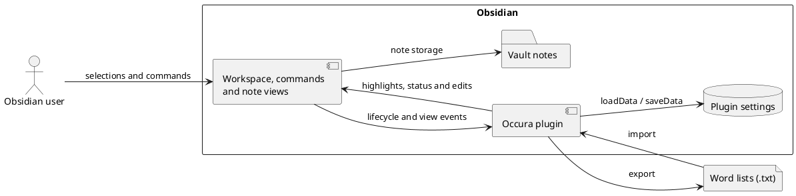
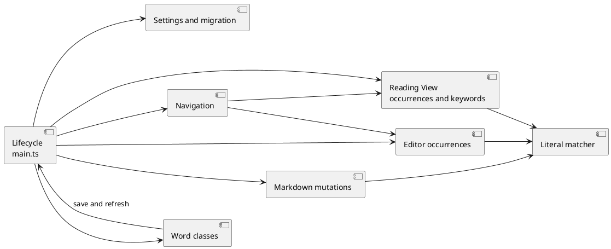

# ARCH:  Occura

**Status:** Accepted
**Date:** 2026-11-21
**Record Type:** Retrospective
**Evidence:** Mixed

## Overview

Occura is an Obsidian plugin that highlights selected text and keyword classes in Source Mode, Live Preview, and Reading View. It also provides occurrence navigation and commands to add or remove permanent highlights and tags. See the README for use and installation. [README.md:18](README.md?plain=1#L18), [README.md:34](README.md?plain=1#L34), [main.ts:83](main.ts#L83), [README.md:145](README.md?plain=1#L145)

## System context

Obsidian loads the plugin and supplies workspace events, commands, editor views, and rendered Markdown. Occura registers these integrations in `OccuraPlugin.onload()`. [main.ts:46](main.ts#L46)

View highlights use CodeMirror decorations or DOM marks. Permanent commands submit source edits through the editor API. Settings use Obsidian persistence. Word lists use browser file APIs. [src/editorOccurrences.ts:289](src/editorOccurrences.ts#L289), [src/readingViewOccurrences.ts:580](src/readingViewOccurrences.ts#L580), [src/markdownMutations.ts:555](src/markdownMutations.ts#L555), [main.ts:145](main.ts#L145), [src/settings.ts:389](src/settings.ts#L389), [src/settings.ts:425](src/settings.ts#L425)

## Repository structure

| Area | Purpose | Source |
|---|---|---|
| Root | Plugin entry point, manifest, styles, and build configuration. | [main.ts:37](main.ts#L37), [manifest.json:2](manifest.json#L2), [styles.css:1](styles.css#L1), [esbuild.config.mjs:18](esbuild.config.mjs#L18) |
| `src/` | Runtime modules described below. | [main.ts:16](main.ts#L16) |
| `tests/` | Unit and DOM regression tests with an Obsidian mock. | [vitest.config.mts:11](vitest.config.mts#L11), [vitest.config.mts:15](vitest.config.mts#L15) |
| `docs/adr/` | Technical decisions and implementation commit links. | [docs/adr/0001-light-and-dark-highlight-colors.md:44](docs/adr/0001-light-and-dark-highlight-colors.md?plain=1#L44) |
| `.github/workflows/` | CI tests, build, and release checks. | [.github/workflows/ci.yml:19](.github/workflows/ci.yml#L19) |
| `MANUAL_TESTING.md` | Checks in Obsidian on desktop and mobile platforms. | [MANUAL_TESTING.md:3](MANUAL_TESTING.md?plain=1#L3) |

## System components

| Module | Responsibility | Source |
|---|---|---|
| `main.ts` | Coordinate lifecycle, commands, status, and view refresh. | [main.ts:46](main.ts#L46), [main.ts:247](main.ts#L247) |
| `settings.ts`, `settingsMigration.ts` | Define settings, provide controls, and check saved values. | [src/settings.ts:21](src/settings.ts#L21), [src/settings.ts:95](src/settings.ts#L95), [src/settingsMigration.ts:72](src/settingsMigration.ts#L72) |
| `matching.ts` | Return literal match ranges with case, Unicode boundary, and minimum length options. | [src/matching.ts:77](src/matching.ts#L77) |
| `editorOccurrences.ts` | Cache selected-text matches and create visible decorations for selections and classes. | [src/editorOccurrences.ts:113](src/editorOccurrences.ts#L113), [src/editorOccurrences.ts:280](src/editorOccurrences.ts#L280) |
| `readingViewOccurrences.ts` | Handle selection and pointer events. Create dynamic DOM marks and preserve selections. | [src/readingViewOccurrences.ts:95](src/readingViewOccurrences.ts#L95), [src/readingViewOccurrences.ts:199](src/readingViewOccurrences.ts#L199) |
| `readingViewKeywords.ts` | Add class marks through a Markdown postprocessor. | [src/readingViewKeywords.ts:50](src/readingViewKeywords.ts#L50) |
| `occurrenceNavigation.ts` | Select and scroll to the next or previous match in the active view. | [src/occurrenceNavigation.ts:71](src/occurrenceNavigation.ts#L71), [src/occurrenceNavigation.ts:137](src/occurrenceNavigation.ts#L137) |
| `markdownMutations.ts` | Plan source changes outside protected ranges. Apply one transaction. | [src/markdownMutations.ts:402](src/markdownMutations.ts#L402), [src/markdownMutations.ts:533](src/markdownMutations.ts#L533) |
| `wordClasses.ts` | Add a selected word to a class from the editor menu. Save settings and refresh views. | [src/wordClasses.ts:74](src/wordClasses.ts#L74), [src/wordClasses.ts:99](src/wordClasses.ts#L99) |
| `keywordColors.ts`, `styles.css` | Set color variables and select Light or Dark colors. | [src/keywordColors.ts:8](src/keywordColors.ts#L8), [styles.css:1](styles.css#L1) |

Arrows show calls or registered integrations. Navigation uses editor match snapshots or Reading View marks. Both display paths and mutation planning call the shared matcher. [src/occurrenceNavigation.ts:8](src/occurrenceNavigation.ts#L8), [src/editorOccurrences.ts:133](src/editorOccurrences.ts#L133), [src/readingViewOccurrences.ts:561](src/readingViewOccurrences.ts#L561), [src/readingViewKeywords.ts:152](src/readingViewKeywords.ts#L152), [src/markdownMutations.ts:442](src/markdownMutations.ts#L442)

## Startup and execution

1. `onload()` loads and migrates settings, creates one status item, and starts the Reading View controller. [main.ts:46](main.ts#L46)
2. It registers the settings tab, CodeMirror extension, and Markdown postprocessor, then sets color variables. [main.ts:54](main.ts#L54)
3. It registers commands, the editor menu, workspace events, and title bar icons. Layout changes refresh document registrations and styles; active-pane changes clear status. [main.ts:66](main.ts#L66), [main.ts:125](main.ts#L125)
4. `onunload()` clears dynamic Reading View marks, status, color variables, and title bar icons. Registered cleanup and editor destruction cancel pending timers. [main.ts:350](main.ts#L350), [src/readingViewOccurrences.ts:61](src/readingViewOccurrences.ts#L61), [src/editorOccurrences.ts:222](src/editorOccurrences.ts#L222)

Editor selection or document changes cancel pending work. A valid selection schedules a scan after 120 ms. The match list covers the full note. Decoration building uses visible ranges. Navigation reuses the match list. Class keywords use Unicode word boundaries and a separate minimum length of one code point. [src/editorOccurrences.ts:47](src/editorOccurrences.ts#L47), [src/editorOccurrences.ts:207](src/editorOccurrences.ts#L207), [src/editorOccurrences.ts:289](src/editorOccurrences.ts#L289), [src/occurrenceNavigation.ts:106](src/occurrenceNavigation.ts#L106), [src/editorOccurrences.ts:322](src/editorOccurrences.ts#L322)

Reading View waits for pointer release, then applies a 120 ms delay. Pointer cancellation cancels pending work. The controller saves selection offsets before DOM changes and restores selections if their nodes are disconnected. Keyword classes run separately during Markdown rendering. [src/readingViewOccurrences.ts:95](src/readingViewOccurrences.ts#L95), [src/readingViewOccurrences.ts:142](src/readingViewOccurrences.ts#L142), [src/readingViewOccurrences.ts:199](src/readingViewOccurrences.ts#L199), [src/readingViewOccurrences.ts:312](src/readingViewOccurrences.ts#L312), [src/readingViewKeywords.ts:50](src/readingViewKeywords.ts#L50)

Mutation commands read editor source, build a change plan, and submit one transaction. The command reports the number of changes. A regression test checks the transaction count. [src/markdownMutations.ts:544](src/markdownMutations.ts#L544), [tests/markdownMutations.test.ts:124](tests/markdownMutations.test.ts#L124)

## Data and state

| State | Owner and lifetime | Source |
|---|---|---|
| Settings | The plugin holds the settings object in `OccuraPlugin.settings`. Obsidian loads and saves it. Migration supplies defaults for missing or incorrect values. | [main.ts:145](main.ts#L145), [src/settingsMigration.ts:72](src/settingsMigration.ts#L72) |
| Keyword classes | Saved settings contain each class ID, name, two colors, keywords, enabled state, and case sensitivity. | [src/settings.ts:10](src/settings.ts#L10) |
| Editor matches | A `WeakMap` stores one entry per editor view. Reuse requires the same document object, query, and options. A test checks array reuse. | [src/editorOccurrences.ts:61](src/editorOccurrences.ts#L61), [src/editorOccurrences.ts:125](src/editorOccurrences.ts#L125), [tests/editorOccurrences.test.ts:102](tests/editorOccurrences.test.ts#L102) |
| Reading View state | The controller holds document registrations, pointer state, a timer, and the last root and query. Dynamic marks hold query metadata. | [src/readingViewOccurrences.ts:50](src/readingViewOccurrences.ts#L50), [src/readingViewOccurrences.ts:585](src/readingViewOccurrences.ts#L585) |
| Note changes | Permanent commands submit planned source ranges through `editor.transaction()`. | [src/markdownMutations.ts:555](src/markdownMutations.ts#L555) |

## Key design decisions

| Decision | Documented reason or effect | Record |
|---|---|---|
| Select Light and Dark colors with CSS. | Existing highlights change with the active color scheme. | [docs/adr/0001-light-and-dark-highlight-colors.md:14](docs/adr/0001-light-and-dark-highlight-colors.md?plain=1#L14) |
| Store keywords in named classes. | Different colors identify terms from different domains. | [docs/adr/0002-keyword-classes.md:14](docs/adr/0002-keyword-classes.md?plain=1#L14) |
| Use DOM marks and wait for pointer release in Reading View. | DOM changes during a gesture can remove native selection handles. | [docs/adr/0003-reading-view-selection.md:14](docs/adr/0003-reading-view-selection.md?plain=1#L14) |
| Share one literal matcher. | Regular expression metacharacters remain literal search text. | [docs/adr/0004-shared-literal-matching.md:14](docs/adr/0004-shared-literal-matching.md?plain=1#L14) |
| Check saved settings at load. | Defaults replace missing or incorrect values. | [docs/adr/0005-saved-settings-validation.md:14](docs/adr/0005-saved-settings-validation.md?plain=1#L14) |
| Cache editor matches for the full note. Render visible matches. | Scrolling does not change the total. The delay permits scan cancellation. | [docs/adr/0006-editor-occurrence-cache.md:14](docs/adr/0006-editor-occurrence-cache.md?plain=1#L14) |
| Plan Markdown changes before one transaction. | One Undo operation can revert the command. | [docs/adr/0007-markdown-edit-transactions.md:14](docs/adr/0007-markdown-edit-transactions.md?plain=1#L14) |
| Use Obsidian input handling. | Preserve spellcheck, folding, and built-in Find behavior. | [docs/adr/0008-obsidian-input-handling.md:14](docs/adr/0008-obsidian-input-handling.md?plain=1#L14) |
| Publish status only from the active pane. | Pane changes and disabling highlighting clear the count. | [docs/adr/0009-active-pane-status.md:14](docs/adr/0009-active-pane-status.md?plain=1#L14) |
| Run tests, build, and release checks in CI. | Version mismatches or an absent or empty bundle cause failure. | [docs/adr/0010-release-checks-in-ci.md:14](docs/adr/0010-release-checks-in-ci.md?plain=1#L14) |

## External dependencies and integrations

- Obsidian supplies plugin APIs. CodeMirror supplies documents, compartments, view plugins, and decorations. The build excludes these host packages from the bundle. [main.ts:6](main.ts#L6), [src/editorOccurrences.ts:6](src/editorOccurrences.ts#L6), [esbuild.config.mjs:20](esbuild.config.mjs#L20)
- TypeScript checks source types. esbuild produces the CommonJS `main.js` bundle with an ES2018 target. [package.json:8](package.json#L8), [esbuild.config.mjs:35](esbuild.config.mjs#L35)
- Vitest runs tests in jsdom with an Obsidian mock. [vitest.config.mts:11](vitest.config.mts#L11), [vitest.config.mts:15](vitest.config.mts#L15)
- CI uses Node.js 20 and `npm ci`, then runs tests, the production build, and release validation. The release validator checks version data and the built artifact. [.github/workflows/ci.yml:17](.github/workflows/ci.yml#L17), [validate-release.mjs:32](validate-release.mjs#L32)

## Known constraints

- Dynamic selections cannot contain line breaks. Phrase selection is optional. The default minimum length is two Unicode code points. [src/editorOccurrences.ts:75](src/editorOccurrences.ts#L75), [src/settings.ts:47](src/settings.ts#L47)
- Reading View skips code, links, metadata, math, and controls. Matching uses individual text nodes, so matches cannot cross node boundaries. [src/readingViewOccurrences.ts:21](src/readingViewOccurrences.ts#L21), [src/readingViewOccurrences.ts:554](src/readingViewOccurrences.ts#L554)
- Editor counts include raw Markdown source. Each uncached query scans the full note synchronously. [src/editorOccurrences.ts:133](src/editorOccurrences.ts#L133)
- Mutation commands accept one selected word and skip protected ranges. Tests cover unclosed code and link constructs. [src/markdownMutations.ts:538](src/markdownMutations.ts#L538), [src/markdownMutations.ts:402](src/markdownMutations.ts#L402), [tests/markdownMutations.test.ts:112](tests/markdownMutations.test.ts#L112)
- Editor integration depends on `editor.cm`. Reading View integration depends on Obsidian DOM classes and optional `previewMode.rerender()`. [src/editorOccurrences.ts:357](src/editorOccurrences.ts#L357), [main.ts:268](main.ts#L268), [src/readingViewOccurrences.ts:240](src/readingViewOccurrences.ts#L240)
- Native selections, mobile gestures, spellcheck, folding, and multiple panes require checks in Obsidian. Use the manual checklist on Windows, macOS, Linux, Android, and iOS. [MANUAL_TESTING.md:3](MANUAL_TESTING.md?plain=1#L3), [MANUAL_TESTING.md:15](MANUAL_TESTING.md?plain=1#L15), [MANUAL_TESTING.md:24](MANUAL_TESTING.md?plain=1#L24)
